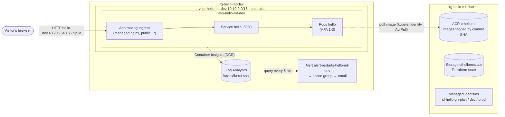
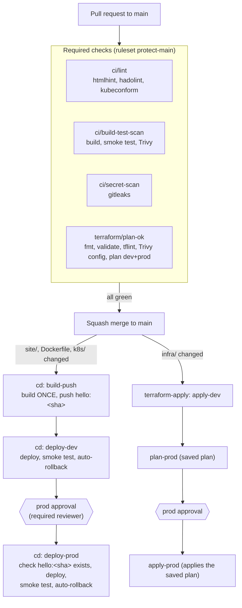

# Architecture: hello platform

A one-page nginx site, run on AKS in two environments (dev and prod), built and deployed by GitHub Actions. Everything in Azure is created by Terraform; no pipeline holds a password or key.

| | |
|---|---|
| Owner | Mohamed Toure |
| Region | East US (`eastus`) |
| Repo | `TheProgrammingPath/hello-mt` |
| Dev URL | http://hello-dev.48.206.54.156.nip.io |
| Prod URL | http://hello-prod.20.242.237.48.nip.io |

## 1. Azure resources and traffic

Dev is shown in full; prod is the same stack (see the table below for what differs).

| | dev | prod |
|---|---|---|
| Resource group | `rg-hello-mt-dev` | `rg-hello-mt-prod` |
| VNet | `10.10.0.0/16` | `10.20.0.0/16` |
| Nodes (Standard_D2s_v5, autoscaled) | 1 to 3, no zones | 2 to 4, zones 1-3 |
| Pods (HPA on CPU 50%) | 1 to 3 | 2 to 6, plus a PodDisruptionBudget (min 1) |
| Log quota | 0.5 GB/day | 1 GB/day |
| Banner (ConfigMap) | "Hello from dev on AKS" | "Hello from production" |
| Deploy approval | none | required reviewer |

Both environments use the same Terraform modules (`network`, `aks`, `monitoring`) and the same Kubernetes base; they differ only in `terraform.tfvars` and the Kustomize overlay.

**Inside the cluster:** Azure CNI Overlay with Cilium, Entra ID login with Azure RBAC (local accounts disabled), Free tier. Pods run as UID 101, non-root, read-only root filesystem, all capabilities dropped. Rollouts use `maxUnavailable: 0` and a 5-second `preStop` so no request is dropped.

## 2. CI/CD flow: how a commit reaches prod

Step by step, for an app change:

1. Open a PR. Four required checks must pass; `main` can't be pushed to directly and has no bypass.
2. Squash merge. The `cd` workflow builds the image **once** and pushes `crhellomt.azurecr.io/hello:<commit sha>`.
3. `deploy-dev` runs `scripts/deploy.sh dev <sha>`, then `scripts/smoke.sh` checks `/version.json` shows that SHA, `/healthz` returns 200 and `/` has the right title. If either step fails, it runs `kubectl rollout undo`.
4. `deploy-prod` waits for approval in the `prod` GitHub environment. **Only the repo owner can approve**, and only runs from `main` can deploy there.
5. Prod never builds. It checks the same `hello:<sha>` is already in ACR, deploys it, smoke-tests it, and rolls back by itself on failure.

Infrastructure follows the same shape: plan on the PR, apply dev on merge, then prod applies the exact plan that was reviewed, after approval. Prod is never applied from a laptop.

A separate workflow, `scan-deployed`, re-scans the newest image in ACR with Trivy every Monday and on demand, because new CVEs are published after an image is built.

## 3. Identities: who can reach what, and how

Nobody and nothing uses a stored password or key. GitHub Actions gets a short-lived token through **OIDC**: Azure only issues it if the token's subject matches exactly.

| Identity | Used by | How it logs in | Can do |
|---|---|---|---|
| `id-hello-gh-plan` | PR checks (`terraform/plan`) and `plan-prod` | OIDC, subject `pull_request` or `ref:refs/heads/main` | **Read only:** Reader on both env RGs and ACR, AKS Cluster User (to read cluster config for the plan), state blobs |
| `id-hello-gh-dev` | `cd` build-push and deploy-dev, `apply-dev`, `scan-deployed` | OIDC, subject `environment:dev` | Owner on `rg-hello-mt-dev`, AcrPush on ACR, AKS RBAC Cluster Admin on the dev cluster, state blobs |
| `id-hello-gh-prod` | `deploy-prod`, `apply-prod` | OIDC, subject `environment:prod`, **only after approval** | Owner on `rg-hello-mt-prod`, AcrPull on ACR (can't push), AKS RBAC Cluster Admin on the prod cluster, state blobs |
| AKS kubelet identity (per cluster) | Nodes pulling images | Managed identity | AcrPull on ACR |
| AKS cluster identity (per cluster) | Load balancer and NICs | Managed identity | Network Contributor on its subnet |
| Owner (Mohamed) | Laptop: bootstrap, troubleshooting | `az login` (Entra ID) | Runs the bootstrap stack; AKS RBAC Cluster Admin on both clusters |

What this means in practice:

- **No identity has a subscription-wide role.** Each pipeline identity is scoped to its own environment's resource group.
- **Dev can't touch prod.** A PR or a dev job can't get the prod identity, because Azure only trusts the `environment:prod` subject, and GitHub only issues it after the reviewer approves.
- **Prod can't change images.** It has AcrPull only, so it can deploy only what dev already built and tested.
- **Clusters accept Entra ID only.** Local admin accounts are disabled, so every `kubectl` call is a named identity checked against Azure RBAC.
- **Public endpoints, identity-gated.** The AKS API and the state storage account are reachable from the internet because GitHub-hosted runners have no fixed IPs. See [ADR 0002](adr/0002-public-endpoints-identity-controls.md).

## 4. Observability

- Container Insights sends pod inventory and container logs (ContainerLogV2, including nginx's access log on stdout) to each environment's Log Analytics workspace, through a Data Collection Rule.
- Alert `alert-restarts-hello-mt-<env>` (Sev2) fires when a container restarts more than 3 times in 30 minutes, and emails the owner through action group `ag-hello-mt-<env>`. The address is a GitHub variable passed to a sensitive Terraform variable; it isn't in the repo.
- Saved queries: [`docs/queries.kql`](queries.kql). Drill and findings: [`docs/evidence.md`](evidence.md).

## Related docs

- [Runbook](runbook.md): how to operate it
- [ADRs](adr/): why it's built this way
- [GitHub settings](github-settings.md): ruleset, environments, variables